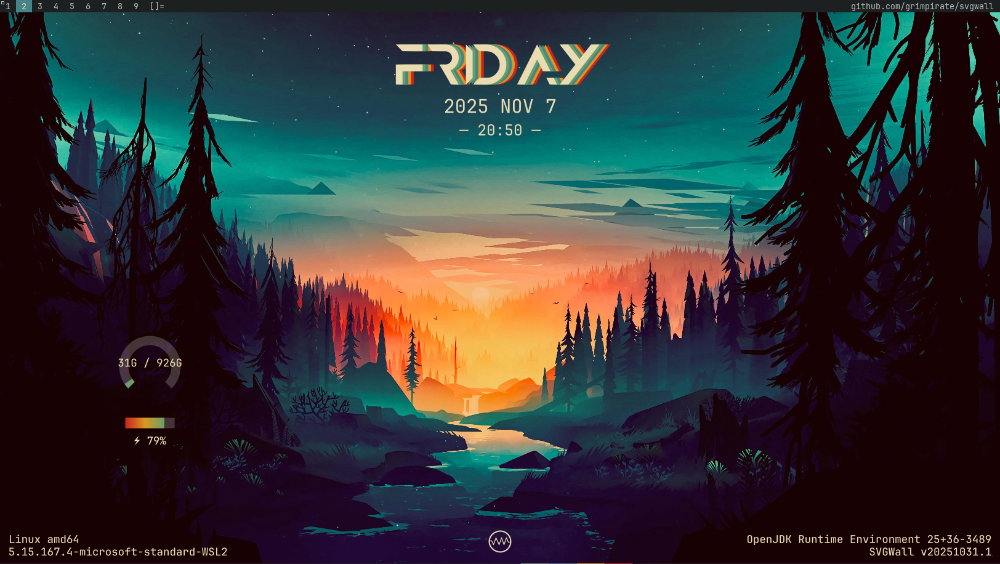

# SVGWall
SVG Wallpaper Utility for Xorg

    Usage: SVGWall-x86_64.AppImage [-chuV] -j=FILE
      -c, --check             Check for SVGWall-x86_64.AppImage update(s) and exit.
      -h, --help              Show this help message and exit.
      -j, --javascript=FILE   SVG generator JavaScript file
      -u, --update            Update SVGWall-x86_64.AppImage and exit.
      -V, --version           Print version information and exit.

### Compile & Package from source

    git clone https://github.com/grimpirate/SVGWall
    cd SVGWall
    chmod +x build.sh
    ./build.sh

### Get latest release

    curl -LO https://github.com/grimpirate/svgwall/releases/latest/download/SVGWall-x86_64.AppImage

### Dynamic Gauge Demo

    chmod +x disk.sh
    ./disk.sh / svg.js BAT1

### slstatus (config.def.h) for use with dwm

    /* interval between updates (in ms) */
    const unsigned int interval = 60000;
    .
    .
    .
    static const struct arg args[] = {
		/* function format          argument */
		{ run_command, "", "/home/$USER/svgwall/scripts/update.sh" },
		{ cat, " %s", "/sys/class/backlight/backlight/actual_brightness" },
		{ ram_perc, " %s%%", NULL },
		{ battery_state, " %s", "sbs-6-000b" },
	};

### .xinitrc

    #!/bin/sh
    
    $HOME/svgwall/scripts/daily.sh &
    slstatus &
    exec dwm
